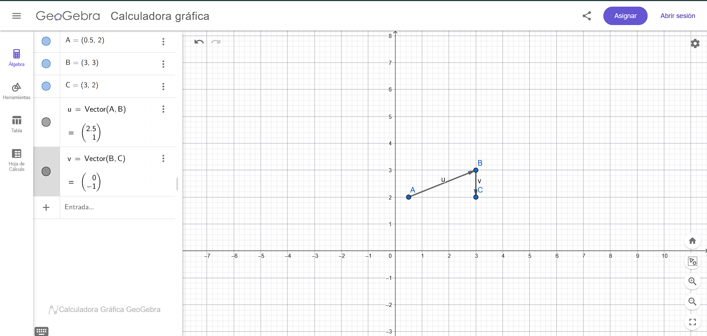

# Taller: Geometría Computacional y Complejidad Algorítmica

**Integrantes:**
* Frank José Miranda Beleño - `0192526`
* Javier Andrés Martínez Martínez - `0192528`

**Asignatura:** Análisis de Algoritmos - Grupo B  
**Docente:** Jesús Eduardo Guerrero Rodríguez  
**Institución:** Universidad Francisco de Paula Santander - Seccional Ocaña  
**Fecha:** 19 de noviembre de 2026  

---

## 1. Robots que deciden hacia dónde girar

Para saber si una ruta está obstruida por una pared, se modela la pared como un segmento de recta y se verifica si el segmento de la trayectoria del robot lo interseca usando pruebas de orientación.

Dada la fórmula del determinante:

$$\det = (x_b - x_a)(y_c - y_a) - (y_b - y_a)(x_c - x_a)$$

* **$\det > 0$:** Giro a la **izquierda** (sentido antihorario).
* **$\det < 0$:** Giro a la **derecha** (sentido horario).
* **$\det = 0$:** Puntos **colineales** (el robot sigue recto).

| Caso | Puntos $(a, b, c)$ | Cálculo del determinante | Resultado | Dirección de giro |
| :--- | :--- | :--- | :---: | :--- |
| **Caso 1** | $a(0.5, 2)$, $b(3, 3)$, $c(3, 2)$ | $(3 - 0.5)(2 - 2) - (3 - 2)(3 - 0.5) = (2.5)(0) - (1)(2.5)$ | **$-2.5$** | **Derecha** (horario) |
| **Caso 2** | $a(1, 2.5)$, $b(3, 2)$, $c(x_c, y_c)$ | $(3 - 1)(y_c - 2.5) - (2 - 2.5)(x_c - 1) = 2(y_c - 2.5) + 0.5(x_c - 1)$ | *Falta punto $c$* | *Depende de $c$* |
| **Caso 3** | $a(1.5, 1)$, $b(3, 2)$, $c(6, 4)$ | $(3 - 1.5)(4 - 1) - (2 - 1)(6 - 1.5) = (1.5)(3) - (1)(4.5)$ | **$0$** | **Colineal** (sigue recto) |
| **Caso 4** | $a(0, 4)$, $b(3, 4)$, $c(3, 1)$ | $(3 - 0)(1 - 4) - (4 - 4)(3 - 0) = (3)(-3) - (0)(3)$ | **$-9$** | **Derecha** (horario) |

### Gráficas en GeoGebra (Punto 1)

* **Caso 1:**
  
* **Caso 2:**
  
* **Caso 3:**
  
* **Caso 4:**
  

---

## 2. Verificación de rutas en autos autónomos

### a) Representación en el plano cartesiano

* **Caso 1:**
  
* **Caso 2:**
  
* **Caso 3:**
  

### b) Cálculo de las 4 orientaciones por caso
Para verificar si el segmento $ab$ interseca al segmento $cd$, calculamos las 4 orientaciones:
1. $o_1 = \text{orientación}(a, b, c)$
2. $o_2 = \text{orientación}(a, b, d)$
3. $o_3 = \text{orientación}(c, d, a)$
4. $o_4 = \text{orientación}(c, d, b)$

* **Caso 1:** $a(1.5, 1), b(3, 2)$ y $c(2, 0.8), d(8, 1.5)$
  * $o_1(a,b,c) = (1.5)(-0.2) - (1)(0.5) = \mathbf{-0.80}$ (Derecha)
  * $o_2(a,b,d) = (1.5)(0.5) - (1)(6.5) = \mathbf{-5.75}$ (Derecha)
  * $o_3(c,d,a) = (6)(0.2) - (0.7)(-0.5) = \mathbf{+1.55}$ (Izquierda)
  * $o_4(c,d,b) = (6)(1.2) - (0.7)(1) = \mathbf{+6.50}$ (Izquierda)
  * **Conclusión:** **No hay intersección** ($o_1 = o_2$ y $o_3 = o_4$).

* **Caso 2:** $a(0, 2), b(4, 2)$ y $c(3, 2), d(9, 2)$
  * $o_1(a,b,c) = (4)(0) - (0)(3) = \mathbf{0}$ (Colineal)
  * $o_2(a,b,d) = (4)(0) - (0)(9) = \mathbf{0}$ (Colineal)
  * $o_3(c,d,a) = (6)(0) - (0)(-3) = \mathbf{0}$ (Colineal)
  * $o_4(c,d,b) = (6)(0) - (0)(1) = \mathbf{0}$ (Colineal)
  * **Conclusión:** **Sí hay intersección** (caso especial colineal con superposición en el intervalo $x \in [3, 4]$).

* **Caso 3:** $a(1, 2), b(3.3, 3.3)$ y $c(5.5, 5.5), d(5.7, 5.7)$
  * $o_1(a,b,c) = (2.3)(3.5) - (1.3)(4.5) = \mathbf{+2.20}$ (Izquierda)
  * $o_2(a,b,d) = (2.3)(3.7) - (1.3)(4.7) = \mathbf{+2.40}$ (Izquierda)
  * $o_3(c,d,a) = (0.2)(-3.5) - (0.2)(-4.5) = \mathbf{+0.20}$ (Izquierda)
  * $o_4(c,d,b) = (0.2)(-2.2) - (0.2)(-2.2) = \mathbf{0}$ (Colineal)
  * **Conclusión:** **No hay intersección** ($o_1 = o_2$, y aunque $o_4 = 0$, el punto $b(3.3, 3.3)$ está fuera del rango $[5.5, 5.7]$ del segmento $cd$).

### c) Función en Python (4 parámetros)

```python
def orientacion(p, q, r):
    val = (q[0] - p[0]) * (r[1] - p[1]) - (q[1] - p[1]) * (r[0] - p[0])
    if round(val, 9) == 0:
        return 0
    elif val > 0:
        return 1
    else:
        return 2

def en_segmento(p, q, r):
    return (min(p[0], r[0]) <= q[0] <= max(p[0], r[0]) and
            min(p[1], r[1]) <= q[1] <= max(p[1], r[1]))

def interseccion(a, b, c, d):
    o1 = orientacion(a, b, c)
    o2 = orientacion(a, b, d)
    o3 = orientacion(c, d, a)
    o4 = orientacion(c, d, b)

    if o1 != o2 and o3 != o4:
        return True

    # Casos colineales
    if o1 == 0 and en_segmento(a, c, b):
        return True
    if o2 == 0 and en_segmento(a, d, b):
        return True
    if o3 == 0 and en_segmento(c, a, d):
        return True
    if o4 == 0 and en_segmento(c, b, d):
        return True

    return False
```

### Complejidad $O(1)$ de la intersección entre dos segmentos
La función `interseccion(a, b, c, d)` tiene complejidad temporal **$O(1)$** (tiempo constante) porque siempre ejecuta un número fijo y acotado de operaciones aritméticas y comparaciones (exactamente 4 determinantes y como máximo 4 verificaciones de rango), independientemente de la longitud de los segmentos o de la magnitud de sus coordenadas.

---

## 3. Empresa de acueducto e intersección de tuberías

El algoritmo de **fuerza bruta** toma cada tubería $i$ (desde $1$ hasta $n-1$) y la compara contra todas las tuberías posteriores $j$ (desde $i+1$ hasta $n$) para evitar repetir pares o comparar una tubería consigo misma.

El número total de pares comparados es:

$$
\binom{n}{2} = \frac{n(n - 1)}{2} = \frac{n^2 - n}{2}
$$

Como cada verificación individual entre dos segmentos cuesta $O(1)$, el tiempo total es proporcional a $\frac{1}{2}n^2 - \frac{1}{2}n$. Al descartar constantes multiplicativas y términos de menor grado, la complejidad asintótica resulta **$O(n^2)$**.

---

## 4. Análisis de iteraciones y llamadas de función

### a) Tabla de iteraciones para $n = 5$ y $n = 8$

| Iteración externa ($i$) | Comparaciones internas ($j$) para $n = 5$ | Nº pares ($n=5$) | Comparaciones internas ($j$) para $n = 8$ | Nº pares ($n=8$) |
| :---: | :--- | :---: | :--- | :---: |
| $i = 1$ | $j \in \{2, 3, 4, 5\}$ | $4$ | $j \in \{2, 3, 4, 5, 6, 7, 8\}$ | $7$ |
| $i = 2$ | $j \in \{3, 4, 5\}$ | $3$ | $j \in \{3, 4, 5, 6, 7, 8\}$ | $6$ |
| $i = 3$ | $j \in \{4, 5\}$ | $2$ | $j \in \{4, 5, 6, 7, 8\}$ | $5$ |
| $i = 4$ | $j \in \{5\}$ | $1$ | $j \in \{5, 6, 7, 8\}$ | $4$ |
| $i = 5$ | — | — | $j \in \{6, 7, 8\}$ | $3$ |
| $i = 6$ | — | — | $j \in \{7, 8\}$ | $2$ |
| $i = 7$ | — | — | $j \in \{8\}$ | $1$ |
| **Total** | **Pares evaluados** | **$10$** | **Pares evaluados** | **$28$** |

### b) Expresión exacta de llamadas
* **Llamadas a `interseccion(a, b, c, d)` (pares de segmentos):**

$$
\text{Llamadas}_{\text{inter}} = \sum_{i=1}^{n-1} (n - i) = \frac{n(n - 1)}{2}
$$

* **Llamadas a determinantes (`orientacion` — 4 por cada llamada a `interseccion`):**

$$
\text{Llamadas}_{\text{det}} = 4 \cdot \frac{n(n - 1)}{2} = 2n(n - 1) = 2n^2 - 2n
$$

### c) Como función matemática
* Función de llamadas a `interseccion`: $f(n) = \frac{1}{2}n^2 - \frac{1}{2}n$
* Función de evaluaciones de determinantes: $g(n) = 2n^2 - 2n$

### d) Desarrollo y simplificación de la sumatoria de constantes
Si denotamos como $c$ el costo constante de cada comprobación (por ejemplo, $c = 4$ determinantes o $c = 1$ llamada a `interseccion`):

$$
T(n) = \sum_{i=1}^{n-1} \sum_{j=i+1}^{n} c = c \sum_{i=1}^{n-1} (n - i) = c \left[ (n-1) + (n-2) + \dots + 1 \right] = c \cdot \frac{n(n - 1)}{2} = \frac{c}{2}n^2 - \frac{c}{2}n
$$

### e) Complejidad temporal
Al eliminar las constantes y conservar el término dominante de mayor crecimiento:

$$
T(n) \in O(n^2)
$$

### f) Comprobaciones para $n = 100$, $1.000$ y $40.000$ tuberías

| Número de tuberías ($n$) | Llamadas a `interseccion(a,b,c,d)` $\frac{n(n-1)}{2}$ | Evaluaciones de determinantes $2n(n-1)$ |
| :---: | :---: | :---: |
| **$100$** | $4.950$ | $19.800$ |
| **$1.000$** | $499.500$ | $1.998.000$ |
| **$40.000$** | $799.980.000$ | $3.199.920.000$ |

---

## 5. Comparación de implementaciones

Conviene utilizar el **Algoritmo B**, ya que tiene un crecimiento cuadrático ($O(n^2)$) frente al cúbico ($O(n^3)$) del Algoritmo A y evita hacer comparaciones innecesarias. A medida que aumenta el tamaño de la entrada $n$, la diferencia de rendimiento se vuelve mucho más notoria, haciendo que el Algoritmo A sea $n$ veces más lento.
n
, el Algoritmo A se vuelve exactamente 
n
 veces más lento que el Algoritmo B.

| Tamaño de entrada ($n$) | $T_A(n) = n^3$ | $T_B(n) = n^2$ | Razón $\frac{T_A(n)}{T_B(n)} = \frac{n^3}{n^2} = n$ | Complejidad Big O |
| :---: | :---: | :---: | :---: | :--- |
| **$10$** | $1.000$ | $100$ | **$10$** | Algoritmo A: $O(n^3)$ |
| **$100$** | $1.000.000$ | $10.000$ | **$100$** | Algoritmo B: $O(n^2)$ |
| **$1.000$** | $1.000.000.000$ | $1.000.000$ | **$1.000$** | **Más eficiente: Algoritmo B** |